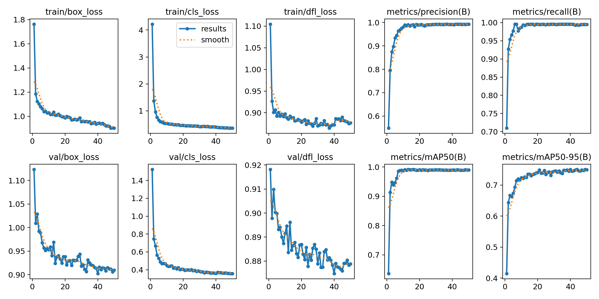
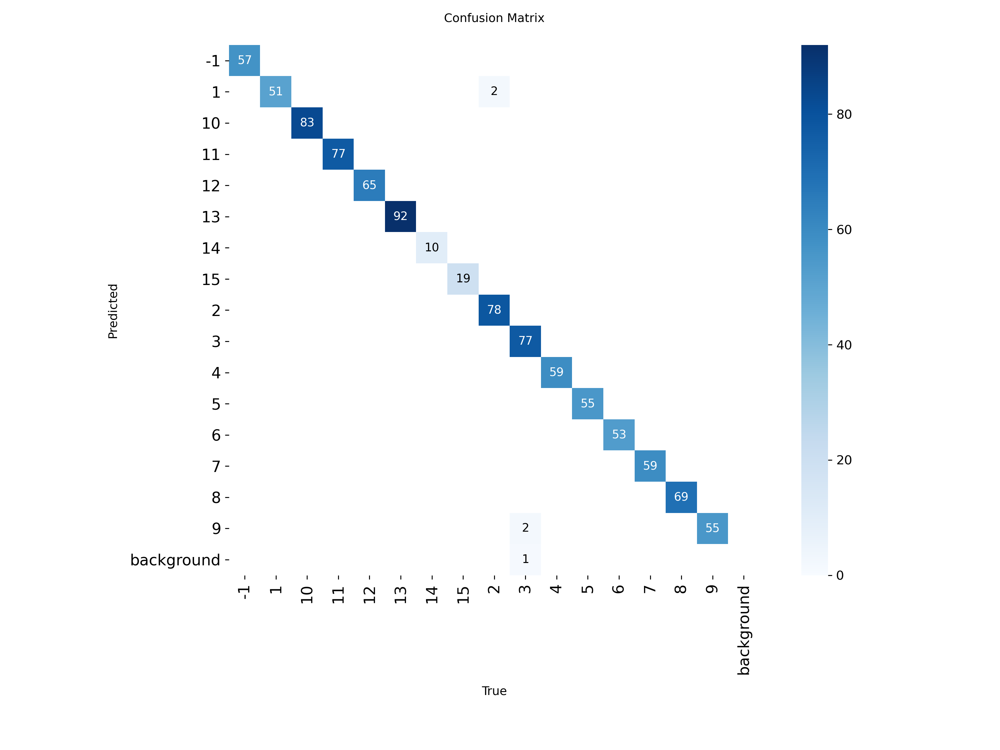

# Happily Struggle Against Landlords (DouZero + YOLOv8 AI Assistant)

A real-time **DouDizhu** desktop assistant combining **YOLOv8** visual card recognition (`weights/best.pt`) with **DouZero** deep reinforcement learning agents (`baselines/douzero_WP/`) inside an always-on-top **PyQt5** overlay.

---

## Key Features

- **Real-Time YOLOv8 Card Recognition**: Continuously detects player hand cards, left/right played cards, and the 3 bottom landlord cards with live inference latency telemetry (`ms`).
- **DouZero Win-Rate & Move Advisor**: Evaluates legal actions via pretrained `landlord`, `landlord_up`, and `landlord_down` deep neural networks, displaying recommended moves and estimated win probability (`%`).
- **Live Unseen Card Counter**: Tracks all 54 cards across turns and surfaces remaining high cards (`D / X / 2 / A / K`) and full unseen rank counts in console and UI tooltips.
- **Interactive Region Calibration & Profile Management**:
  - Two-click on-screen bounding-box calibration or manual `x,y,w,h` entry.
  - One-click **1080p Defaults Reset**, **Import Profile**, and **Export Profile** (`config/regions.json`).
  - Mouse-following live YOLO debug window (**Debug Mode**).
- **CLI Region Overlay & Validator (`pos_debug.py`)**: Inspect, validate, and render color-coded capture region overlays onto saved screenshots or live desktop captures.

---

## Training Results




---

## Installation

```bash
python -m venv .venv
.\.venv\Scripts\activate
pip install -r requirements.txt
```

---

## Usage

### 1. Desktop Assistant (`main.py`)

1. Run the game in windowed or borderless mode (`1920x1080` recommended).
2. Launch the PyQt5 assistant:
   ```bash
   python main.py
   ```
3. Verify regions using **Calibrate** (or press `q` to close the live Region Preview window).
4. Once cards are dealt and the Landlord badge appears, click **Start** to receive real-time DouZero move suggestions and win-rate estimates.
5. Click **Stop** at any time to abort the current round cleanly.

### 2. CLI Region Validator & Overlay Tool (`pos_debug.py`)

```bash
# Validate config/regions.json against 1920x1080 bounds (JSON output)
python pos_debug.py --validate

# Render labeled capture boxes onto a saved screenshot
python pos_debug.py --image game_screen.png --output annotated_regions.png
```

---

## Repository Structure

- `main.py` / `MainWindowUI.py` / `MainWindow.ui`: PyQt5 desktop GUI, YOLOv8 inference loop, and interactive calibration controller.
- `card_tracker.py`: Card rank encoding, YOLO class mapping, unseen deck counter, and region validation helpers.
- `pos_debug.py`: Headless/interactive CLI region overlay visualizer and bounds validator.
- `douzero/`: DouZero game environment, legal move generator/detector/selector, and neural network evaluation wrapper.
- `weights/best.pt`: Trained YOLOv8 card-detection weights.
- `baselines/douzero_WP/`: Pretrained DouZero win-probability checkpoints (`landlord.ckpt`, `landlord_up.ckpt`, `landlord_down.ckpt`).
- `config/regions.json`: Persisted screen-capture region coordinates.

---

## Running Tests

```bash
python -m unittest discover -s tests -v
```

---

## A Lighthearted Note

"Struggle against landlords" used to be a historical phrase, and at the card table it is simply a classic strategy game: one round, one laugh, and another shuffle.
